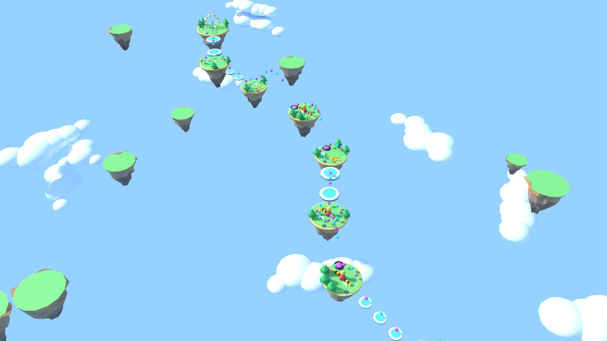
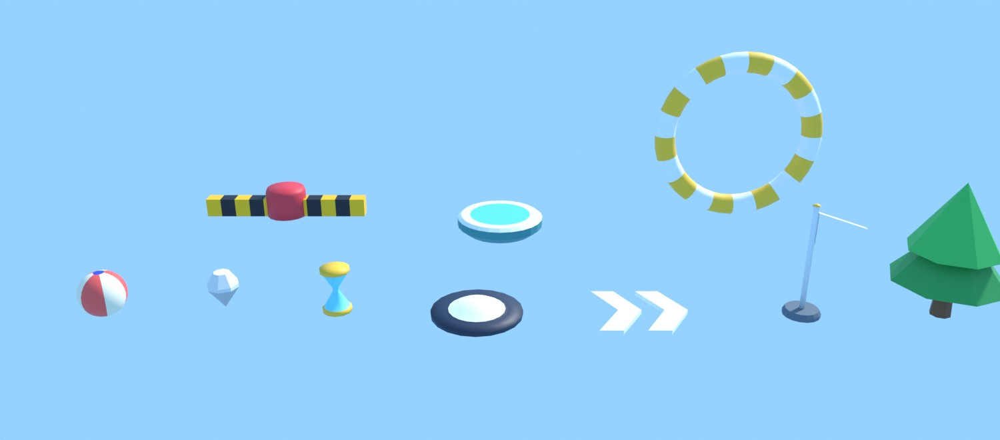

# Gem Roller

A physics marble game for **Unreal Engine 5**, with every piece of art made by **Blender scripts**.

You roll a beach-ball marble across a chain of floating islands: grab gems for combos, hop stepping stones,
ride moving platforms, launch off jump pads, dodge hazard bars, and roll through the golden ring before the
clock runs out. Every course is generated from a seed, so each run is different and any run can be replayed.



<sub>Above: seed 2024, rendered in Blender straight from the course generator's output. Below: the Blender-made props.</sub>



---

## Quick start

You need **Unreal Engine 5.4 or newer** and a C++ toolchain for it (Visual Studio 2022 on Windows, Xcode on Mac).
Blender is *not* required: the generated FBX/WAV files are committed.

1. Clone the repo and open `GemRoller.uproject`. Say yes when Unreal offers to build the module.
   (If you have a different 5.x than 5.4: right-click the `.uproject` → *Switch Unreal Engine version…*.)
2. In the editor: **Tools → Execute Python Script…** and pick `Tools/ImportAssets.py`.
   It imports the meshes and sounds, builds the master material and creates the `Arena` level.
   The log tells you if anything is the wrong size.
3. Open `Content/GemRoller/Maps/Arena` and press **Play**.

That's it. The level is empty on purpose: the game mode builds the whole course (islands, props, sun and sky)
at runtime, so Gem Roller runs on *any* level. You can even press Play before step 2 and get engine-primitive
placeholders; the HUD says so.

Headless import, if you prefer: `UnrealEditor-Cmd GemRoller.uproject -run=pythonscript -script=Tools/ImportAssets.py`.

## Controls

| | Keyboard + mouse | Gamepad |
|---|---|---|
| Roll | `W A S D` | left stick |
| Look | mouse, or `Q` / `E` (arrow keys too) | right stick |
| Jump | `Space` | A / Cross |
| Dash | `Shift` (1.6 s cooldown) | right bumper / X |
| Retry this course | `R` | Start |
| Roll a new course | `N` | Y / Triangle |

## How it plays

* **Gems** are worth 10; **golden gems** 50 (they sit above spinner hubs and out on island rims, so they are a gamble).
  Collect the next gem within 2.2 s to raise the combo multiplier (x1 up to x6). Getting shoved by a spinner breaks it.
* **Time crystals** (hourglasses) add 6 s. Reaching a new island is a checkpoint: +100 points and +3 s.
* **Falling** costs 4 s and sends you back to the last island you reached.
* **Jump pads** (the cyan domes) fire you to the next island on an exact arc, and the first one is lined with gems to
  follow. **Boost pads** (chevrons) fling you forward. **Stepping stones** need small jumps. **Moving platforms** need timing.
  **Spinners** shove you off if you hit them from the side; they are low enough to jump over.
* Roll through the **golden ring** to finish: +500, plus 10 points per second left. Your best score is saved.

Courses are 9 islands long. Start one by seed with the URL option `?Seed=1234` (and `?Islands=12` for a longer one);
the HUD shows the current seed in the corner.

## How it is built

```
Blender/generate_assets.py ──► Assets/FBX/*.fbx ──┐
Tools/make_sounds.py       ──► Assets/Audio/*.wav ┼─► Tools/ImportAssets.py ──► /Game/GemRoller/...
                                                   │       (meshes, sounds, M_GR_Master material, Arena map)
Source/GemRoller/GRLayout.h ── seed ──► course ────┴─► AGemRollerGameMode builds it at runtime
```

**Blender** (`Blender/generate_assets.py`) builds 16 meshes from code: a beach-ball marble, faceted gems, an hourglass,
floating-island slabs with hanging rocks, a hazard-striped spinner, jump and boost pads, a flag, the finish ring, trees
and clouds. Colours are painted as vertex colours, so a single material covers everything. It exports FBX with
"FBX units scale" so a model built in metres arrives in Unreal at the right size in centimetres, and it can render
previews and save a showcase `.blend` (`Blender/GemRoller_Assets.blend`).

**The course generator** (`Source/GemRoller/GRLayout.h`) is plain C++ with no Unreal types. A seed becomes islands, links
between them (jump pad / stepping stones / moving platform), gems, time crystals, boost pads, trees and scenery. It
places jump pads using real ballistic math, and the pad recomputes its launch from wherever the marble actually is,
so it always lands on the target island.

**The game** (`Source/GemRoller/`):

| File | Job |
|---|---|
| `GemRollerGameMode` | generates + spawns the course, scoring, combo, timer, checkpoints, restart |
| `MarblePawn` | physics sphere, rolling, jump (coyote time + input buffer), dash, orbit camera |
| `CourseProp` | one actor for everything in the course: gems, pads, platforms, spinners, goal, scenery |
| `GemRollerHUD` | all UI, drawn on the canvas (no UMG assets) |
| `GemSkyRig` | sun, sky light and atmosphere, spawned if the level has no sun |
| `GRAssets` | finds Blender assets by path, falls back to engine shapes, builds materials, plays sounds |

Design choices worth knowing:

* **No binary Unreal assets are committed.** The only editor-authored things are made by `ImportAssets.py`.
* **Collision never depends on an imported mesh.** The marble is a plain physics sphere; solid props get invisible engine
  cylinders/cubes of the right size. Blender meshes are visual only.
* **Input is polled from the player controller**, so there are no Input Mapping assets to author. (`DefaultInput.ini` selects
  the plain input classes for that reason.)
* Gravity is `-1500` (`DefaultEngine.ini`); `GRLayout.h` assumes the same number when it places jump arcs.

## Regenerating the art

You only need this to change the art. Python 3.11 with `pip install bpy` works, or use an installed Blender:

```bash
python Blender/generate_assets.py --preview Assets/Preview      # FBX + .blend + preview renders
blender -b -P Blender/generate_assets.py -- --out Assets/FBX    # same, with Blender installed
python Tools/make_sounds.py                                     # WAV effects (standard library only)

# render any seed exactly as the game assembles it
g++ -std=c++17 -I Source/GemRoller Tools/LayoutTests/layout_dump.cpp -o /tmp/layout_dump
/tmp/layout_dump 77 > /tmp/course.json
python Blender/render_course.py /tmp/course.json /tmp/seed77.jpg
```

Then re-run `Tools/ImportAssets.py` in the editor.

## Tuning

Everything is a number you can change:

* `AMarblePawn` (Details panel, or edit the defaults): `MoveAccel`, `MaxSpeed`, `AirControl`, `JumpSpeed`, `DashSpeed`,
  `DashCooldown`, `MouseSensitivity`, `bInvertY`.
* `AGemRollerGameMode`: `NumIslands`, `GemValue`, `GoldenGemValue`, `MaxCombo`, `ComboWindow`, `FallPenalty`,
  `TimeCrystalBonus`, `IslandTimeBonus`.
* `GRLayout.h`: island sizes, gap ranges per link type, pattern probabilities.
* `M_GR_Master` parameters: `Tint`, `Emissive`, `Roughness`, `Metallic`, `VertexGamma`.

## Tests

The course generator is tested on its own, with no engine needed:

```bash
g++ -std=c++17 -O1 -Wall -Wextra -Wshadow -I Source/GemRoller Tools/LayoutTests/layout_test.cpp -o /tmp/layout_test && /tmp/layout_test
```

It generates about 3,400 courses and checks, among other things, that islands never overlap, every jump arc lands on its
island (even when launched from the edge of the pad), stepping-stone gaps are crossable, moving platforms meet both islands,
gems never overlap, a course never repeats one link type three times in a row, and the same seed always gives the same course.

## What has and has not been verified

Be aware of this before you build:

* **Verified here:** the Blender generator runs end to end; the FBX files were parsed to confirm unit scale (100),
  sizes, vertex colours and UVs; previews were rendered and inspected; the sound effects were checked by FFT for pitch;
  the course generator passes the tests above.
* **Not verified:** the Unreal C++ has **never been compiled against a real engine**, and `ImportAssets.py` has never run in a
  real editor (there was no Unreal install available where this was written). The C++ was syntax-checked against a
  hand-written stub of the Unreal API, which checks the code is self-consistent but not that every engine call matches your
  engine version, and `ImportAssets.py` was run against a mocked `unreal` module. Expect that you might fix a compile error
  or two on the first build, and the feel (speeds, jump height, camera) has been worked out on paper, not play-tested.

## Troubleshooting

* **Meshes are 100x too big/small:** the import log prints a size check. Change `IMPORT_UNIFORM_SCALE` at the top of
  `Tools/ImportAssets.py` and run it again.
* **Colours look washed out:** open `M_GR_Master` (or an instance) and raise `VertexGamma` towards 2.2.
* **Everything is a grey/white shape:** the Blender art is not imported yet; run `Tools/ImportAssets.py`.
* **No sound:** run `python Tools/make_sounds.py`, then the import script.
* **`Execute Python Script` is missing:** enable the *Python Editor Script Plugin* (the `.uproject` already lists it), restart.
* **Camera or controls feel wrong:** see *Tuning*; `bInvertY` flips the vertical look.
